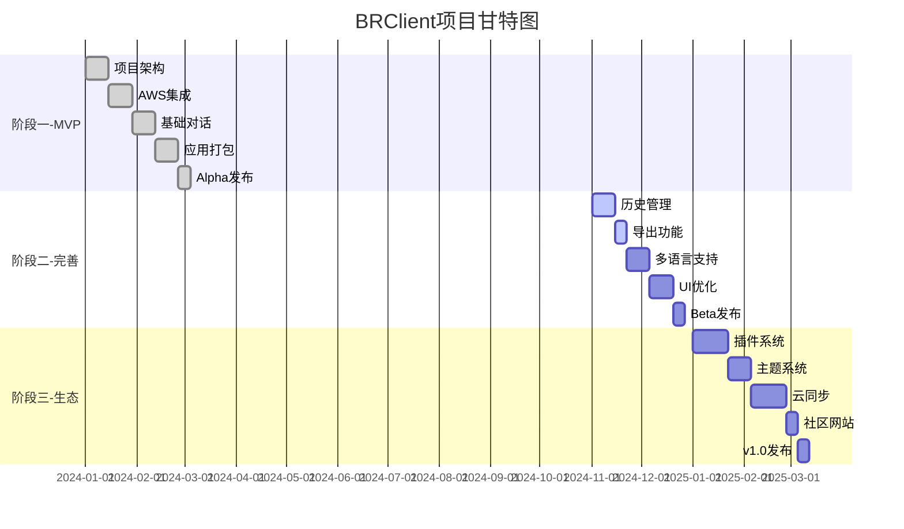

# BRClient 商业需求文档 (BRD)

## 文档信息
- **项目名称**: BRClient
- **文档版本**: v1.0
- **编制日期**: 2025年12月
- **编制人**: 产品团队
- **审核人**: 管理层

---

## 1. 项目背景与目标

### 1.1 项目背景
随着人工智能技术的快速发展，大语言模型(LLM)已成为企业提升效率的重要工具。Amazon Bedrock作为AWS提供的全托管服务，为企业提供了访问多种基础模型的能力，特别是Claude系列模型在理解和生成方面表现出色。

当前市场存在以下问题：
- 现有ChatGPT客户端功能复杂，对于只需要使用AWS Bedrock服务的用户过于臃肿
- 企业用户需要符合安全合规要求的本地化部署方案
- 缺少专门针对AWS Bedrock优化的桌面客户端应用
- 现有解决方案配置复杂，学习成本高

### 1.2 项目目标
**总体目标**: 开发一款轻量级、易用的AWS Bedrock桌面客户端，为企业和个人用户提供便捷的AI对话服务。

**具体目标**:
1. **功能目标**: 提供简洁高效的Claude模型对话界面，支持多轮对话、历史记录管理
2. **性能目标**: 响应时间<2秒，支持流式输出，本地存储无延迟
3. **用户目标**: 3个月内获得1000+活跃用户，用户满意度>85%
4. **技术目标**: 跨平台支持(Windows/Mac)，Docker化部署支持
5. **商业目标**: 建立开源社区，为后续商业化铺路

---

## 2. 市场分析与竞争研究

### 2.1 市场规模
- **全球AI对话市场**: 预计2025年达到300亿美元
- **企业级AI应用**: 年增长率45%
- **AWS Bedrock用户**: 保守估计10万+企业客户

### 2.2 目标市场
- **主要市场**: 使用AWS服务的企业客户
- **次要市场**: AI开发者、个人创作者
- **地域重点**: 北美、欧洲、亚太地区

### 2.3 竞争分析

#### 直接竞争对手
| 产品 | 优势 | 劣势 | 市场份额 |
|------|------|------|----------|
| ChatGPT-Next-Web | 功能丰富、开源 | 配置复杂、支持模型多但不专注 | 15% |
| AWS Console | 官方支持 | 界面不友好、功能有限 | 25% |
| 第三方API工具 | 灵活性高 | 需要编程知识 | 10% |

#### 间接竞争对手
- OpenAI官方客户端
- Google Bard
- Microsoft Copilot

### 2.4 竞争优势
1. **专注性**: 仅支持AWS Bedrock，避免功能臃肿
2. **易用性**: 简化配置流程，开箱即用
3. **开源性**: MIT协议，社区驱动
4. **本地化**: 支持私有部署，数据安全
5. **跨平台**: Windows/Mac/Docker全覆盖

---

## 3. 商业价值与ROI分析

### 3.1 商业价值

#### 用户价值
- **效率提升**: 相比Web控制台，操作效率提升60%
- **成本节约**: 开源免费，相比商业产品节省$50-200/月
- **数据安全**: 本地部署，满足企业安全要求
- **学习成本**: 配置时间从2小时降低到10分钟

#### 企业价值
- **品牌建设**: 建立技术品牌影响力
- **用户获取**: 开源社区带来自然流量
- **数据洞察**: 了解用户需求，指导产品迭代
- **商业转化**: 为后续付费服务铺路

### 3.2 ROI分析

#### 投入估算
| 项目 | 成本 | 说明 |
|------|------|------|
| 开发人力 | $50,000 | 2名开发，3个月 |
| 设计支持 | $5,000 | UI/UX设计 |
| 基础设施 | $2,000 | 服务器、域名、CI/CD |
| 营销推广 | $3,000 | 社区运营、文档 |
| **总计** | **$60,000** | 首年投入 |

#### 收益预测(12个月)
| 类型 | 收益 | 说明 |
|------|------|------|
| 直接收益 | $0 | 开源阶段暂无直接收益 |
| 品牌价值 | $30,000 | 品牌曝光、技术影响力 |
| 用户数据 | $20,000 | 用户洞察、市场验证 |
| 商业线索 | $15,000 | 潜在客户、合作机会 |
| **总计** | **$65,000** | 首年预期收益 |

**ROI**: (65,000 - 60,000) / 60,000 = 8.3%

### 3.3 长期商业模式

#### 阶段一: 开源免费(0-12个月)
- 建立用户基础
- 收集反馈迭代
- 形成品牌认知

#### 阶段二: 增值服务(12-24个月)
- 企业版功能(团队协作、管理后台)
- 技术支持服务
- 定制开发服务

#### 阶段三: 平台化(24个月+)
- SaaS化部署
- API服务商
- 模型市场

---

## 4. 目标用户画像

### 4.1 主要用户群体

#### 用户画像1: 企业技术经理
- **基本信息**: 
  - 年龄: 30-45岁
  - 职位: 技术经理/架构师
  - 收入: $80k-150k
  
- **痛点**:
  - 需要为团队部署AI工具
  - 关注数据安全和合规
  - 预算有限，倾向开源方案
  
- **使用场景**:
  - 代码审查辅助
  - 技术文档生成
  - 团队知识库问答
  
- **关键需求**:
  - 易于部署和管理
  - 支持私有化部署
  - 良好的文档和支持

#### 用户画像2: AI开发者
- **基本信息**:
  - 年龄: 25-35岁
  - 职位: 软件工程师/AI研究员
  - 收入: $60k-120k
  
- **痛点**:
  - 需要快速测试不同模型
  - 希望自定义和扩展功能
  - 需要本地开发环境
  
- **使用场景**:
  - 模型效果测试
  - Prompt工程实验
  - AI应用原型开发
  
- **关键需求**:
  - 开源可定制
  - 支持API调用
  - 开发者友好

#### 用户画像3: 内容创作者
- **基本信息**:
  - 年龄: 25-40岁
  - 职位: 作家/营销人员/自媒体
  - 收入: $40k-80k
  
- **痛点**:
  - 需要AI辅助创作
  - 希望界面简洁易用
  - 关注使用成本
  
- **使用场景**:
  - 文章写作辅助
  - 创意头脑风暴
  - 内容润色优化
  
- **关键需求**:
  - 简单易用
  - 稳定可靠
  - 支持长文本

### 4.2 用户规模预测

| 时间 | 注册用户 | 活跃用户 | 日活用户 |
|------|----------|----------|----------|
| 3个月 | 2,000 | 1,000 | 200 |
| 6个月 | 5,000 | 2,500 | 500 |
| 12个月 | 15,000 | 8,000 | 1,500 |

---

## 5. 业务模式设计

### 5.1 当前业务模式
**开源社区模式**: 采用MIT开源协议，完全免费

**收入来源**: 
- 暂无直接收入
- 依靠赞助和捐赠
- 母公司品牌建设

### 5.2 未来业务模式演进

#### 模式1: Freemium模式
- **免费版**: 基础功能，个人使用
- **专业版**: 高级功能，$9.9/月
  - 云端同步
  - 历史记录无限
  - 优先支持
- **企业版**: 团队协作，$49.9/月起
  - 多用户管理
  - SSO集成
  - 专属支持

#### 模式2: 服务模式
- **部署服务**: $500-2000一次性
- **培训服务**: $200/小时
- **定制开发**: $5000+

#### 模式3: 生态模式
- **插件市场**: 收取交易手续费(20%)
- **模板市场**: 收取分成
- **API服务**: 按调用量收费

### 5.3 合作伙伴策略
- **AWS合作**: 申请AWS合作伙伴认证
- **集成商**: 与企业服务商合作
- **开源社区**: 加入CNCF等组织

---

## 6. 风险评估与缓解策略

### 6.1 技术风险

#### 风险1: AWS API变更
- **影响**: 高
- **概率**: 中
- **缓解措施**:
  - 关注AWS官方公告
  - 保持SDK版本更新
  - 实现API版本兼容层
  - 建立自动化测试

#### 风险2: 性能问题
- **影响**: 中
- **概率**: 中
- **缓解措施**:
  - 实现流式响应
  - 优化本地存储
  - 加入性能监控
  - 负载测试覆盖

#### 风险3: 安全漏洞
- **影响**: 高
- **概率**: 低
- **缓解措施**:
  - 定期安全审计
  - 依赖库及时更新
  - 实现安全编码规范
  - 建立漏洞响应流程

### 6.2 市场风险

#### 风险1: 竞品冲击
- **影响**: 中
- **概率**: 高
- **缓解措施**:
  - 保持快速迭代
  - 深度用户运营
  - 建立技术壁垒
  - 强化品牌建设

#### 风险2: 用户增长缓慢
- **影响**: 中
- **概率**: 中
- **缓解措施**:
  - 加强社区运营
  - 内容营销投入
  - 合作伙伴推广
  - 用户激励计划

### 6.3 业务风险

#### 风险1: 依赖AWS平台
- **影响**: 高
- **概率**: 低
- **缓解措施**:
  - 保持平台独立性
  - 预留扩展接口
  - 考虑多云支持
  - 建立备选方案

#### 风险2: 开源协议争议
- **影响**: 中
- **概率**: 低
- **缓解措施**:
  - 清晰的协议说明
  - CLA贡献者协议
  - 法律咨询支持
  - 代码来源追溯

### 6.4 合规风险

#### 风险1: 数据隐私
- **影响**: 高
- **概率**: 中
- **缓解措施**:
  - GDPR合规设计
  - 数据本地存储
  - 隐私政策完善
  - 用户数据控制

#### 风险2: 出口管制
- **影响**: 中
- **概率**: 低
- **缓解措施**:
  - 了解相关法规
  - 地区使用限制
  - 法律团队支持

---

## 7. 项目里程碑与时间规划

### 7.1 项目阶段划分

#### 阶段一: MVP开发(已完成)
**时间**: 2024年Q1-Q2
**目标**: 基础功能实现

**里程碑**:
- ✅ M1.1: 项目架构搭建(Week 1-2)
- ✅ M1.2: AWS Bedrock集成(Week 3-4)
- ✅ M1.3: 基础对话功能(Week 5-6)
- ✅ M1.4: 桌面应用打包(Week 7-8)
- ✅ M1.5: Alpha版本发布(Week 9)

**交付物**:
- 可运行的桌面应用
- 基础文档
- GitHub仓库

#### 阶段二: 功能完善(当前阶段)
**时间**: 2024年Q3-Q4
**目标**: 增强用户体验

**里程碑**:
- 🔄 M2.1: 历史记录管理(Week 10-11)
- 🔄 M2.2: 对话导出功能(Week 12)
- 📅 M2.3: 多语言支持(Week 13-14)
- 📅 M2.4: UI/UX优化(Week 15-16)
- 📅 M2.5: Beta版本发布(Week 17)

**交付物**:
- Beta版本
- 用户文档
- API文档

#### 阶段三: 生态建设(规划中)
**时间**: 2025年Q1-Q2
**目标**: 构建开源社区

**里程碑**:
- 📅 M3.1: 插件系统(Week 18-20)
- 📅 M3.2: 主题系统(Week 21-22)
- 📅 M3.3: 云同步功能(Week 23-25)
- 📅 M3.4: 社区网站上线(Week 26)
- 📅 M3.5: v1.0正式版(Week 27)

**交付物**:
- v1.0版本
- 社区网站
- 插件市场

### 7.2 详细时间表

### 7.3 关键决策点

| 时间节点 | 决策内容 | 决策依据 |
|----------|----------|----------|
| Week 9 | 是否继续投入 | Alpha版用户反馈、技术可行性 |
| Week 17 | 商业化方向 | 用户规模、市场反馈 |
| Week 27 | 是否启动企业版 | 收入目标、团队规模 |

### 7.4 资源需求计划

#### 人力资源
| 角色 | 阶段一 | 阶段二 | 阶段三 |
|------|--------|--------|--------|
| 前端开发 | 1人 | 1人 | 2人 |
| 后端开发 | 1人 | 1人 | 1人 |
| UI设计师 | 0.5人 | 0.5人 | 1人 |
| 产品经理 | 0.5人 | 1人 | 1人 |
| 测试工程师 | 0人 | 0.5人 | 1人 |

#### 技术资源
- **开发环境**: GitHub, VS Code, Docker
- **CI/CD**: GitHub Actions
- **监控**: Sentry, Google Analytics
- **文档**: GitHub Wiki, GitBook

---

## 8. 成功指标(KPI)

### 8.1 用户指标
- **注册用户数**: 12个月达到15,000
- **月活用户(MAU)**: 8,000
- **日活用户(DAU)**: 1,500
- **用户留存率**: D7=40%, D30=25%
- **用户满意度**: NPS>40

### 8.2 产品指标
- **启动时间**: <3秒
- **对话响应时间**: <2秒
- **崩溃率**: <0.1%
- **功能使用率**: 核心功能>80%

### 8.3 技术指标
- **代码覆盖率**: >70%
- **安全漏洞**: 0个高危
- **性能评分**: Lighthouse>90
- **可用性**: >99.5%

### 8.4 商业指标
- **GitHub Stars**: 12个月达到5,000
- **社区贡献者**: 50+
- **合作伙伴**: 5+
- **媒体曝光**: 10+篇报道

---

## 9. 附录

### 9.1 术语表
- **LLM**: Large Language Model，大语言模型
- **Bedrock**: AWS提供的AI模型服务平台
- **Claude**: Anthropic公司开发的大语言模型
- **Tauri**: 用于构建跨平台桌面应用的框架
- **NPS**: Net Promoter Score，净推荐值

### 9.2 参考文档
- AWS Bedrock官方文档
- ChatGPT-Next-Web项目
- 竞品分析报告
- 用户调研报告

### 9.3 审批记录
| 审批人 | 角色 | 审批意见 | 日期 |
|--------|------|----------|------|
| - | 产品总监 | 待审批 | - |
| - | 技术总监 | 待审批 | - |
| - | CEO | 待审批 | - |

---

**文档结束**
