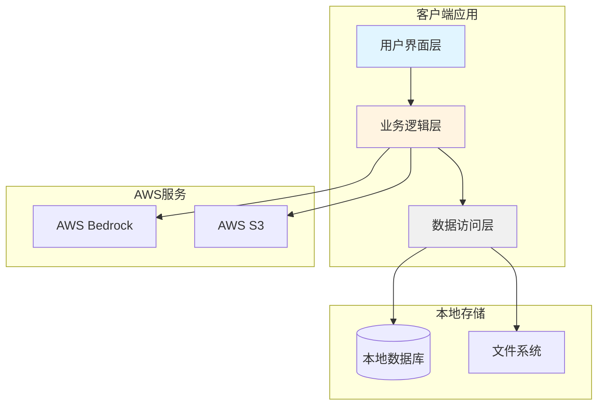
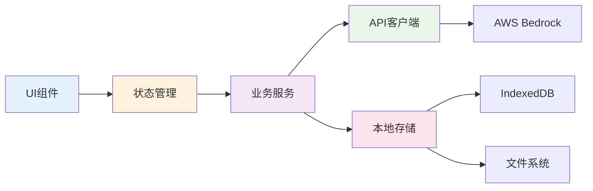
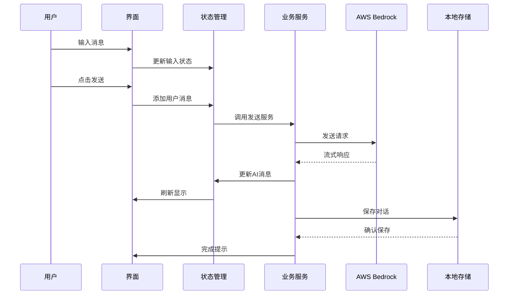
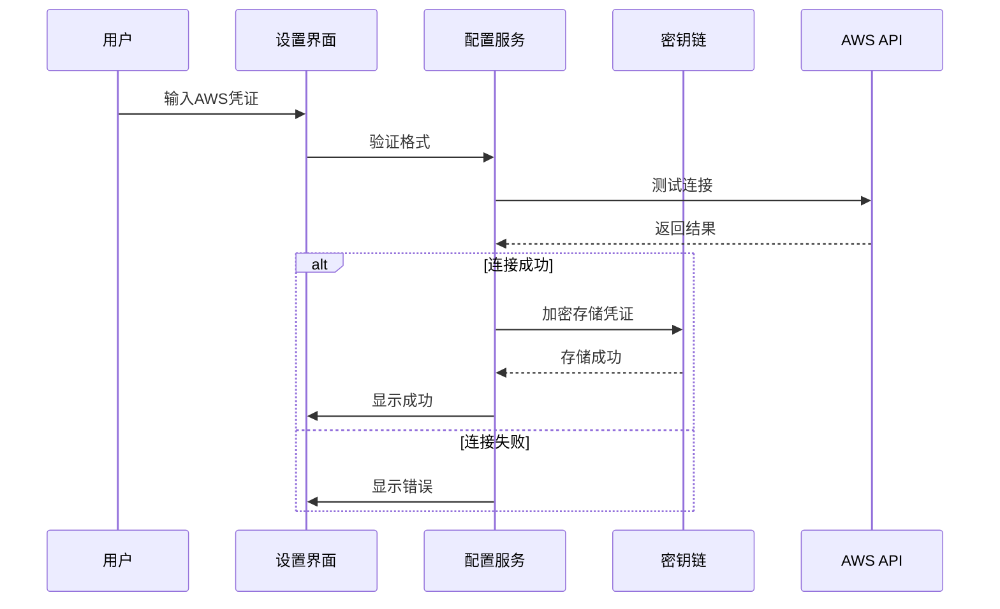
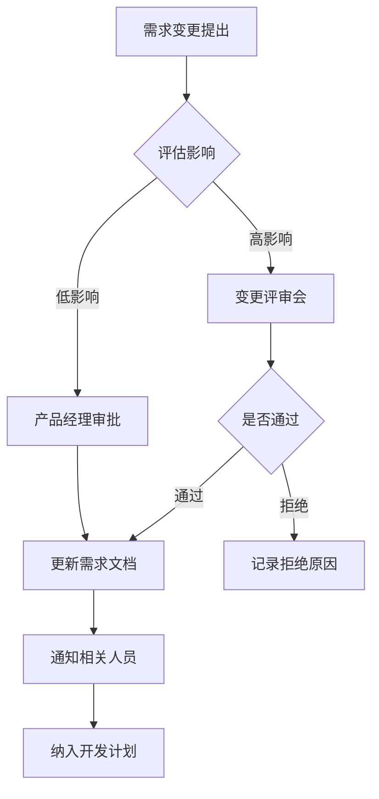

# BRClient 产品需求文档 (PRD)

## 文档信息
- **项目名称**: BRClient
- **文档版本**: v1.0
- **编制日期**: 2025年12月
- **编制人**: 产品团队
- **基于文档**: BRD v1.0

---

## 1. 产品概述与定位

### 1.1 产品定义
BRClient是一款专注于AWS Bedrock服务的轻量级桌面客户端应用，为用户提供简洁、高效、安全的AI对话体验。

### 1.2 产品定位
- **核心定位**: AWS Bedrock专用客户端
- **目标用户**: 企业技术团队、AI开发者、内容创作者
- **差异化**: 专注、简洁、开源、跨平台

### 1.3 产品愿景
成为AWS Bedrock用户的首选客户端工具，构建活跃的开源社区。

### 1.4 产品原则
1. **简单至上**: 降低使用门槛，开箱即用
2. **性能优先**: 快速响应，流畅体验
3. **安全可靠**: 数据本地存储，隐私保护
4. **开放生态**: 开源协议，插件扩展

---

## 2. 功能需求列表

### 2.1 功能优先级定义
- **P0**: 核心功能，必须实现
- **P1**: 重要功能，尽快实现
- **P2**: 增强功能，计划实现
- **P3**: 扩展功能，未来考虑

### 2.2 功能清单

#### 2.2.1 用户管理模块

##### F1.1 账号配置 (P0)
**功能描述**: 用户配置AWS访问凭证和区域设置

**需求详情**:
- 支持AWS Access Key ID/Secret配置
- 支持AWS Region选择（下拉列表）
- 支持配置验证（测试连接）
- 支持凭证加密存储
- 支持多账号配置切换

**验收标准**:
- [ ] 可输入和保存AWS凭证
- [ ] 可选择AWS区域
- [ ] 配置保存后可正常调用API
- [ ] 凭证本地加密存储
- [ ] 错误配置有明确提示

##### F1.2 用户偏好设置 (P1)
**功能描述**: 用户个性化设置

**需求详情**:
- 语言设置（中文/英文等）
- 主题设置（亮色/暗色）
- 字体大小调整
- 快捷键自定义
- 对话设置（温度、最大长度等）

**验收标准**:
- [ ] 设置可保存和恢复
- [ ] 主题切换实时生效
- [ ] 语言切换完整覆盖
- [ ] 快捷键不冲突

#### 2.2.2 对话管理模块

##### F2.1 创建对话 (P0)
**功能描述**: 创建新的对话会话

**需求详情**:
- 支持快速创建空白对话
- 支持选择模型创建（Claude3 Sonnet/Haiku）
- 支持基于模板创建
- 支持设置对话标题
- 支持设置系统提示词

**验收标准**:
- [ ] 点击新建按钮创建对话
- [ ] 可选择不同模型
- [ ] 对话自动生成默认标题
- [ ] 支持自定义标题
- [ ] 系统提示词可配置

##### F2.2 发送消息 (P0)
**功能描述**: 用户发送消息并接收AI回复

**需求详情**:
- 支持文本输入（支持多行）
- 支持Markdown格式
- 支持流式响应显示
- 支持停止生成
- 支持重新生成
- 显示消息时间戳
- 显示Token消耗统计

**验收标准**:
- [ ] 文本正确发送到Bedrock
- [ ] 流式响应实时显示
- [ ] 可随时停止生成
- [ ] 可重新生成回答
- [ ] Markdown正确渲染
- [ ] Token统计准确

##### F2.3 对话历史 (P0)
**功能描述**: 查看和管理历史对话

**需求详情**:
- 左侧边栏显示对话列表
- 支持对话搜索
- 支持对话排序（时间/标题）
- 支持对话删除
- 支持对话归档
- 显示对话摘要
- 显示最后更新时间

**验收标准**:
- [ ] 对话列表正确显示
- [ ] 搜索功能准确
- [ ] 删除需要确认
- [ ] 归档对话不显示在主列表
- [ ] 对话切换无延迟

##### F2.4 对话编辑 (P1)
**功能描述**: 编辑已有对话内容

**需求详情**:
- 支持编辑消息内容
- 支持删除单条消息
- 支持复制消息内容
- 支持消息重新发送
- 保留编辑历史

**验收标准**:
- [ ] 可编辑任意历史消息
- [ ] 编辑后可重新生成
- [ ] 删除消息有确认
- [ ] 复制保留格式

##### F2.5 对话导出 (P1)
**功能描述**: 导出对话内容

**需求详情**:
- 支持导出为Markdown
- 支持导出为PDF
- 支持导出为图片
- 支持选择导出范围
- 支持批量导出

**验收标准**:
- [ ] Markdown格式正确
- [ ] PDF排版美观
- [ ] 图片清晰完整
- [ ] 可选择导出部分消息

#### 2.2.3 模型管理模块

##### F3.1 模型选择 (P0)
**功能描述**: 选择和切换AI模型

**需求详情**:
- 显示可用模型列表
- 显示模型描述信息
- 支持实时切换模型
- 显示模型参数配置
- 模型可用性检测

**验收标准**:
- [ ] 列出Claude3 Sonnet/Haiku
- [ ] 模型切换生效
- [ ] 显示模型特点描述
- [ ] 不可用模型置灰

##### F3.2 模型参数配置 (P1)
**功能描述**: 配置模型生成参数

**需求详情**:
- Temperature调节（0-1）
- Top P调节（0-1）
- 最大Token数设置
- 停止序列配置
- 参数预设模板

**验收标准**:
- [ ] 参数调整实时生效
- [ ] 参数范围验证
- [ ] 预设模板可选择
- [ ] 显示参数说明

#### 2.2.4 界面交互模块

##### F4.1 响应式布局 (P0)
**功能描述**: 适配不同屏幕尺寸

**需求详情**:
- 支持窗口缩放
- 支持全屏模式
- 侧边栏可折叠
- 组件自适应布局
- 最小窗口尺寸限制

**验收标准**:
- [ ] 不同尺寸下布局正常
- [ ] 全屏无遮挡
- [ ] 侧边栏折叠流畅
- [ ] 最小宽度800px

##### F4.2 快捷键支持 (P1)
**功能描述**: 键盘快捷操作

**需求详情**:
- Ctrl/Cmd + N: 新建对话
- Ctrl/Cmd + K: 搜索对话
- Ctrl/Cmd + Enter: 发送消息
- Ctrl/Cmd + /: 快捷键帮助
- ESC: 停止生成
- Ctrl/Cmd + B: 切换侧边栏

**验收标准**:
- [ ] 所有快捷键生效
- [ ] 快捷键不冲突
- [ ] 帮助文档完整
- [ ] 跨平台兼容

##### F4.3 主题系统 (P1)
**功能描述**: 自定义界面主题

**需求详情**:
- 内置亮色主题
- 内置暗色主题
- 自动跟随系统
- 自定义主题色
- 主题导入导出

**验收标准**:
- [ ] 主题切换流畅
- [ ] 所有组件适配主题
- [ ] 系统主题自动跟随
- [ ] 自定义主题保存

##### F4.4 多语言支持 (P2)
**功能描述**: 界面多语言显示

**需求详情**:
- 中文简体
- 英文
- 日文
- 韩文
- 其他主要语言
- 语言包热更新

**验收标准**:
- [ ] 界面文本完整翻译
- [ ] 语言切换无需重启
- [ ] 日期时间本地化
- [ ] 错误信息多语言

#### 2.2.5 数据管理模块

##### F5.1 本地存储 (P0)
**功能描述**: 对话数据本地持久化

**需求详情**:
- 对话内容本地存储
- 用户配置本地存储
- 数据加密存储
- 支持数据备份
- 支持数据恢复

**验收标准**:
- [ ] 数据关闭后保留
- [ ] 敏感信息加密
- [ ] 备份文件可用
- [ ] 恢复功能正常

##### F5.2 云端同步 (P2)
**功能描述**: 多设备数据同步

**需求详情**:
- 支持AWS S3同步
- 支持WebDAV同步
- 冲突检测和解决
- 增量同步
- 同步状态显示

**验收标准**:
- [ ] 数据正确同步
- [ ] 冲突可解决
- [ ] 同步状态清晰
- [ ] 支持手动同步

##### F5.3 数据导入导出 (P1)
**功能描述**: 数据迁移支持

**需求详情**:
- 导出所有对话数据
- 导入对话数据
- 支持JSON格式
- 支持批量操作
- 数据格式验证

**验收标准**:
- [ ] 导出数据完整
- [ ] 导入数据正确
- [ ] 格式错误有提示
- [ ] 支持大文件

---

## 3. 非功能需求

### 3.1 性能需求

#### 3.1.1 响应时间
| 操作 | 目标时间 | 最大时间 |
|------|----------|----------|
| 应用启动 | 2秒 | 3秒 |
| 创建对话 | 100ms | 200ms |
| 发送消息 | 500ms | 1秒 |
| 首字响应 | 1秒 | 2秒 |
| 对话切换 | 100ms | 300ms |
| 搜索结果 | 200ms | 500ms |

#### 3.1.2 资源占用
- **内存占用**: 空闲<150MB，使用<500MB
- **CPU占用**: 空闲<5%，生成中<30%
- **磁盘空间**: 安装<200MB，数据<10MB/千条对话
- **网络流量**: 平均<1KB/字，流式传输

#### 3.1.3 并发性能
- 支持同时进行3个对话生成
- 支持50+对话无性能下降
- 支持10000+历史消息浏览

### 3.2 可用性需求

#### 3.2.1 稳定性
- 崩溃率: <0.1%
- 无响应率: <0.5%
- 数据丢失率: 0%
- 连续运行: >24小时无问题

#### 3.2.2 兼容性
- **操作系统**: 
  - Windows 10/11 (x64)
  - macOS 11+ (Intel & Apple Silicon)
  - Linux (Ubuntu 20.04+)
- **浏览器**（Web版）:
  - Chrome 90+
  - Firefox 88+
  - Safari 14+
  - Edge 90+
- **屏幕分辨率**: 1280x720最小，4K优化

#### 3.2.3 可访问性
- 支持键盘导航
- 支持屏幕阅读器
- 高对比度模式
- 字体缩放支持

### 3.3 安全需求

#### 3.3.1 数据安全
- AWS凭证使用操作系统密钥链存储
- 对话数据AES-256加密
- 不传输敏感数据到第三方
- 支持数据完全删除

#### 3.3.2 网络安全
- HTTPS强制加密
- 证书验证
- 代理支持
- 请求签名验证

#### 3.3.3 应用安全
- 代码签名
- 自动更新验证
- 沙箱运行
- 最小权限原则

### 3.4 可维护性需求

#### 3.4.1 代码质量
- 代码覆盖率: >70%
- 代码审查: 100%
- 静态分析: 0个严重问题
- 技术债务: <5%

#### 3.4.2 文档完整性
- API文档完整
- 用户手册完善
- 开发者指南
- 架构设计文档

#### 3.4.3 可扩展性
- 插件系统支持
- 主题扩展支持
- API版本管理
- 向后兼容保证

---

## 4. 用户故事与用例

### 4.1 用户故事

#### 故事1: 快速开始使用
**作为** 新用户  
**我希望** 能快速配置并开始使用  
**以便于** 立即体验AI对话功能

**验收标准**:
- 首次启动有引导流程
- 配置步骤不超过3步
- 有示例对话可参考
- 配置错误有清晰提示

#### 故事2: 日常工作助手
**作为** 开发者  
**我希望** 能快速查询技术问题  
**以便于** 提高工作效率

**验收标准**:
- 可保存常用提示词模板
- 支持代码高亮显示
- 可快速复制代码片段
- 历史对话可搜索

#### 故事3: 内容创作辅助
**作为** 内容创作者  
**我希望** AI能帮我优化文章  
**以便于** 提升内容质量

**验收标准**:
- 支持长文本输入
- 可逐步优化内容
- 可比较不同版本
- 可导出最终内容

#### 故事4: 团队协作
**作为** 团队管理者  
**我希望** 能分享有价值的对话  
**以便于** 团队知识共享

**验收标准**:
- 可导出对话链接
- 可生成分享文件
- 可设置访问权限
- 支持批量导出

### 4.2 主要用例

#### 用例1: 创建并进行对话

**前置条件**: 
- 用户已配置AWS凭证
- 应用已启动

**主流程**:
1. 用户点击"新建对话"按钮
2. 系统创建新对话并切换到该对话
3. 用户在输入框输入问题
4. 用户按Enter或点击发送按钮
5. 系统调用AWS Bedrock API
6. 系统流式显示AI回复
7. 对话完成，等待下一次输入

**异常流程**:
- 3a. 输入为空，提示用户输入内容
- 5a. API调用失败，显示错误信息
- 6a. 用户点击停止，中断生成

**后置条件**:
- 对话内容已保存
- 可继续对话或创建新对话

#### 用例2: 配置AWS凭证

**前置条件**: 
- 用户已安装应用
- 用户已有AWS账号和凭证

**主流程**:
1. 用户打开设置界面
2. 用户点击"AWS配置"选项
3. 用户输入Access Key ID
4. 用户输入Secret Access Key
5. 用户选择AWS Region
6. 用户点击"测试连接"
7. 系统验证凭证有效性
8. 用户点击"保存"
9. 系统加密存储凭证

**异常流程**:
- 7a. 凭证无效，显示错误提示
- 7b. 网络连接失败，提示检查网络
- 7c. Region不支持Bedrock，提示更换

**后置条件**:
- 凭证已安全保存
- 可正常使用AI功能

#### 用例3: 导出对话历史

**前置条件**: 
- 存在至少一个对话

**主流程**:
1. 用户打开对话列表
2. 用户选择要导出的对话
3. 用户点击"导出"按钮
4. 系统显示导出选项对话框
5. 用户选择导出格式（Markdown/PDF）
6. 用户选择保存位置
7. 系统生成导出文件
8. 系统提示导出成功

**异常流程**:
- 7a. 磁盘空间不足，提示用户
- 7b. 权限不足，提示用户选择其他位置

**后置条件**:
- 对话已导出为文件
- 原对话保持不变

---

## 5. 产品架构设计

### 5.1 系统架构图



### 5.2 技术架构

#### 5.2.1 前端架构
```
Next.js 13+ (React 18)
├── Pages
│   ├── Home（对话界面）
│   ├── Settings（设置界面）
│   └── Auth（认证界面）
├── Components
│   ├── Chat（对话组件）
│   ├── Sidebar（侧边栏）
│   ├── MessageList（消息列表）
│   └── InputBox（输入框）
├── Store (Zustand)
│   ├── ChatStore（对话状态）
│   ├── ConfigStore（配置状态）
│   └── UserStore（用户状态）
└── Services
    ├── BedrockService（Bedrock服务）
    ├── StorageService（存储服务）
    └── ExportService（导出服务）
```

#### 5.2.2 桌面应用架构
```
Tauri
├── Core（Rust后端）
│   ├── 文件系统操作
│   ├── 密钥链管理
│   └── 系统集成
└── WebView（前端）
    └── Next.js应用
```

### 5.3 模块关系图



### 5.4 数据模型

#### 对话模型
```typescript
interface Conversation {
  id: string;
  title: string;
  modelId: string;
  systemPrompt: string;
  messages: Message[];
  createdAt: Date;
  updatedAt: Date;
  isArchived: boolean;
  tags: string[];
}
```

#### 消息模型
```typescript
interface Message {
  id: string;
  role: 'user' | 'assistant' | 'system';
  content: string;
  timestamp: Date;
  tokenCount: number;
  metadata?: {
    model: string;
    temperature: number;
    stopReason: string;
  };
}
```

#### 配置模型
```typescript
interface Config {
  aws: {
    region: string;
    accessKeyId: string; // 加密存储
    secretAccessKey: string; // 加密存储
  };
  ui: {
    theme: 'light' | 'dark' | 'auto';
    language: string;
    fontSize: number;
  };
  model: {
    defaultModel: string;
    temperature: number;
    maxTokens: number;
  };
}
```

---

## 6. 数据流图

### 6.1 对话流程



### 6.2 配置流程



---

## 7. 需求变更管理流程

### 7.1 变更流程



### 7.2 变更类型

| 类型 | 审批级别 | 响应时间 |
|------|----------|----------|
| Bug修复 | 开发负责人 | 1天 |
| 小功能优化 | 产品经理 | 3天 |
| 新功能添加 | 评审会 | 1周 |
| 架构变更 | 技术委员会 | 2周 |

### 7.3 变更记录

| 版本 | 日期 | 变更内容 | 变更类型 | 审批人 |
|------|------|----------|----------|--------|
| v1.0 | 2025-12-21 | 初始版本 | 新建 | - |
| - | - | - | - | - |

---

## 8. 验收标准

### 8.1 功能验收
- [ ] 所有P0功能100%实现
- [ ] 所有P1功能>=80%实现
- [ ] 所有功能通过测试用例
- [ ] 用户故事验收标准达成

### 8.2 性能验收
- [ ] 性能指标达到目标值
- [ ] 压力测试通过
- [ ] 内存泄漏测试通过
- [ ] 长时间运行测试通过

### 8.3 质量验收
- [ ] 代码审查通过率100%
- [ ] 单元测试覆盖率>70%
- [ ] 集成测试覆盖核心流程
- [ ] 安全扫描无高危问题

### 8.4 文档验收
- [ ] 用户手册完整
- [ ] API文档完整
- [ ] 部署文档完整
- [ ] 常见问题文档完整

---

## 9. 附录

### 9.1 缩写说明
- **PRD**: Product Requirements Document，产品需求文档
- **UI**: User Interface，用户界面
- **API**: Application Programming Interface，应用程序接口
- **AWS**: Amazon Web Services
- **SDK**: Software Development Kit，软件开发工具包

### 9.2 参考资料
- [AWS Bedrock API文档](https://docs.aws.amazon.com/bedrock/)
- [Next.js官方文档](https://nextjs.org/docs)
- [Tauri官方文档](https://tauri.app/)
- BRD v1.0

### 9.3 审批记录

| 审批人 | 角色 | 审批意见 | 日期 |
|--------|------|----------|------|
| - | 产品经理 | 待审批 | - |
| - | 技术负责人 | 待审批 | - |
| - | UI设计师 | 待审批 | - |
| - | 项目经理 | 待审批 | - |

---

**文档结束**
