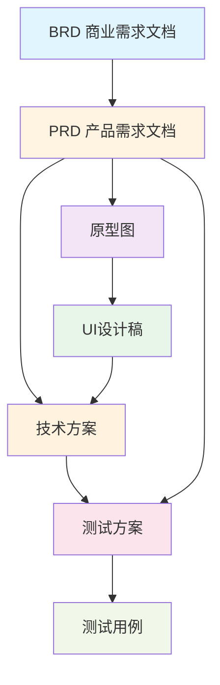

# BRClient 产品文档目录

## 📚 文档概览

本目录包含 BRClient（一线运维智能问答系统）的完整产品文档集，涵盖从商业规划到技术实现的全方位内容。

---

## 🗂️ 核心产品文档

### 1️⃣ [BRD.md - 商业需求文档](./BRD.md)
**Business Requirements Document**

详细描述项目的商业价值和战略规划。

**主要内容：**
- 📊 项目背景与市场分析
- 💼 商业价值与收益模型
- 👥 目标用户画像
- 🎯 商业模式设计
- ⚠️ 风险评估与应对
- 📅 项目里程碑规划

**适用人群：** 高层管理者、投资人、产品负责人

---

### 2️⃣ [PRD.md - 产品需求文档](./PRD.md)
**Product Requirements Document**

完整的产品功能需求和规格说明。

**主要内容：**
- 🎯 产品概述与定位
- ⭐ 核心功能列表
- 📊 功能优先级划分
- 📖 用户故事集合
- 🏗️ 产品架构设计
- 🔄 业务流程覆盖
- ⚡ 性能要求规范

**适用人群：** 产品经理、开发团队、测试团队

---

### 3️⃣ [原型图.md - 产品原型设计](./原型图.md)
**Product Prototype Design**

产品交互和界面结构的原型设计。

**主要内容：**
- 🗺️ 信息架构规划
- 🔀 用户流程图
- 📱 核心页面线框图
- 🖱️ 交互设计说明
- ✨ 特殊交互效果
- 🎨 原型演示说明

**适用人群：** UI/UX设计师、产品经理、前端开发

---

### 4️⃣ [UI设计稿.md - 用户界面设计](./UI设计稿.md)
**User Interface Design**

详细的视觉设计规范和界面设计。

**主要内容：**
- 🎨 设计理念与原则
- 🌈 色彩方案体系
- 📝 字体系统规范
- 🧩 核心组件设计
- 📐 界面布局标准
- 📱 移动端适配方案
- 🌙 深色模式设计
- 🏷️ 品牌元素应用

**适用人群：** UI设计师、前端开发、品牌团队

---

### 5️⃣ [技术方案.md - 技术架构设计](./技术方案.md)
**Technical Architecture Design**

完整的技术选型和架构设计方案。

**主要内容：**
- 🛠️ 技术栈选型
- 🤖 NLP技术实现
- 💬 对话系统架构
- 📚 知识库技术方案
- 🎙️ 语音技术集成
- ⚡ 缓存策略设计
- 📊 监控体系建设
- 🔒 安全方案设计

**适用人群：** 架构师、后端开发、运维团队

---

### 6️⃣ [测试方案.md - 测试策略设计](./测试方案.md)
**Testing Strategy Design**

全面的测试策略和质量保障方案。

**主要内容：**
- 🎯 测试策略规划
- 🖥️ 测试环境配置
- 📊 测试数据准备
- 🤖 AI算法测试方法
- ⚡ 性能测试方案
- 📱 兼容性测试矩阵
- 🔒 安全测试策略
- 👤 用户体验测试

**适用人群：** 测试工程师、质量保障团队、开发团队

---

### 7️⃣ [测试用例.md - 详细测试用例](./测试用例.md)
**Detailed Test Cases**

可执行的详细测试用例集合。

**主要内容：**
- ✅ 基础功能测试用例
- 💬 智能对话测试用例
- 📚 知识库测试用例
- ⚡ 性能测试用例
- 🎙️ 语音功能测试用例
- 📱 移动端测试用例
- 🔄 回归测试用例
- 🐛 缺陷验证用例

**适用人群：** 测试工程师、开发团队、质量保障

---

## 📖 其他文档

### 用户文档
- [user-manual-cn.md](./user-manual-cn.md) - 中文用户手册
- [faq-cn.md](./faq-cn.md) - 常见问题解答（中文）
- [faq-en.md](./faq-en.md) - FAQ (English)

### 部署文档
- [vercel-cn.md](./vercel-cn.md) - Vercel部署指南
- [cloudflare-pages-cn.md](./cloudflare-pages-cn.md) - Cloudflare Pages部署指南

### 功能文档
- [synchronise-chat-logs-cn.md](./synchronise-chat-logs-cn.md) - 聊天记录同步

---

## 🔗 文档关系图

---

## 📋 文档阅读建议

### 👔 管理层/决策者
阅读顺序：`BRD.md` → `PRD.md` → `技术方案.md`

### 🎨 产品/设计团队
阅读顺序：`BRD.md` → `PRD.md` → `原型图.md` → `UI设计稿.md`

### 💻 开发团队
阅读顺序：`PRD.md` → `技术方案.md` → `原型图.md` → `UI设计稿.md`

### 🧪 测试团队
阅读顺序：`PRD.md` → `测试方案.md` → `测试用例.md`

### 👤 新成员入职
阅读顺序：`BRD.md` → `PRD.md` → `技术方案.md` → `UI设计稿.md`

---

## 📊 文档统计

| 文档名称 | 页数估算 | 图表数量 | 最后更新 |
|---------|---------|---------|---------|
| BRD.md | ~15页 | 1个Mermaid图 | 2025-12 |
| PRD.md | ~25页 | 5个Mermaid图 | 2025-12 |
| 原型图.md | ~35页 | 4个Mermaid图 | 2025-12 |
| UI设计稿.md | ~25页 | 多个设计示例 | 2025-12 |
| 技术方案.md | ~25页 | 1个Mermaid图 | 2025-12 |
| 测试方案.md | ~20页 | 2个Mermaid图 | 2025-12 |
| 测试用例.md | ~20页 | 测试用例表格 | 2025-12 |

---

## 🔄 文档版本控制

所有文档当前版本：**v1.0**

版本更新遵循语义化版本规则：
- **主版本号**：重大架构变更
- **次版本号**：功能增删
- **修订号**：内容修正和优化

---

## 📞 文档反馈

如发现文档问题或有改进建议，请：
1. 在项目中提交 Issue
2. 联系产品团队
3. 提交 Pull Request

---

## 📜 文档许可

本文档集遵循项目 MIT 开源协议。

---

**最后更新时间**: 2025年12月  
**文档维护**: BRClient 产品团队
