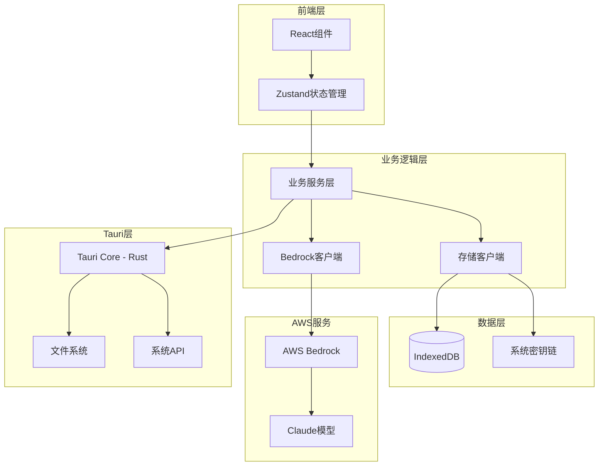

# BRClient 技术架构设计文档

## 文档信息
- **项目名称**: BRClient
- **文档版本**: v1.0
- **编制日期**: 2025年12月
- **编制人**: 技术架构团队
- **基于文档**: PRD v1.0, UI设计稿 v1.0

---

## 1. 技术栈选择

### 1.1 前端技术栈

#### 1.1.1 核心框架
```
框架: Next.js 13+
- 原因: 支持SSR/SSG、优秀的性能、丰富的生态
- 版本: 13.4.9
- 特性: App Router、Server Components、API Routes

UI库: React 18
- 原因: 成熟稳定、社区活跃、生态完善
- 版本: 18.2.0
- 特性: Hooks、Concurrent Features、Suspense
```

#### 1.1.2 状态管理
```
Zustand
- 原因: 轻量级、API简洁、TypeScript支持好
- 用途: 全局状态管理
- 存储: chat, config, user, ui状态
```

#### 1.1.3 样式方案
```
SASS/SCSS
- 原因: 功能强大、变量/嵌套支持
- 组织: CSS Modules + 全局样式
- 主题: CSS变量实现主题切换
```

#### 1.1.4 Markdown渲染
```
react-markdown + rehype/remark插件
- 代码高亮: rehype-highlight
- 数学公式: rehype-katex
- GFM支持: remark-gfm
```

### 1.2 桌面应用技术

#### 1.2.1 Tauri框架
```
版本: 1.5.7
优势:
- 小体积 (~5MB vs Electron ~50MB)
- 低资源占用
- 原生性能
- 安全性高

架构:
- Frontend: Next.js (WebView)
- Backend: Rust
- IPC: Tauri命令系统
```

#### 1.2.2 系统集成
```
文件系统:
- tauri::api::file - 文件读写
- tauri::api::dialog - 文件选择对话框

系统:
- tauri::api::notification - 系统通知
- tauri::window - 窗口管理
- tauri::clipboard - 剪贴板操作
```

### 1.3 后端服务

#### 1.3.1 API层
```
Next.js API Routes
- 路径: /app/api/*
- 功能: 代理AWS请求、处理认证
- 中间件: CORS、错误处理
```

#### 1.3.2 AWS SDK
```
@aws-sdk/client-bedrock-runtime: ^3.427.0
- BedrockRuntimeClient
- InvokeModelCommand
- InvokeModelWithResponseStreamCommand

@aws-sdk/client-bedrock: ^3.427.0
- BedrockClient
- ListFoundationModelsCommand
```

### 1.4 数据存储

#### 1.4.1 本地存储
```
IndexedDB (使用Dexie.js)
- 对话数据: conversations表
- 消息数据: messages表
- 用户配置: config表
- 索引: timestamp, searchable_content
```

#### 1.4.2 安全存储
```
Tauri Keychain API
- AWS凭证加密存储
- 使用系统密钥链
- 平台: Keychain(macOS), Credential Manager(Windows)
```

---

## 2. 系统架构设计

### 2.1 整体架构图



### 2.2 分层架构

#### 2.2.1 表现层 (Presentation Layer)
```
职责:
- UI组件渲染
- 用户交互处理
- 路由管理
- 主题切换

技术:
- React组件
- Next.js Router
- CSS Modules
- React Hooks
```

#### 2.2.2 业务逻辑层 (Business Logic Layer)
```
职责:
- 对话管理
- 消息处理
- 配置管理
- 数据同步

模块:
- ChatService: 对话业务逻辑
- MessageService: 消息处理
- ConfigService: 配置管理
- SyncService: 数据同步
```

#### 2.2.3 数据访问层 (Data Access Layer)
```
职责:
- 数据持久化
- 缓存管理
- 查询优化
- 事务处理

实现:
- StorageRepository
- CacheManager
- QueryBuilder
```

#### 2.2.4 外部服务层 (External Service Layer)
```
职责:
- AWS Bedrock API调用
- 认证和授权
- 错误重试
- 限流控制

实现:
- BedrockClient
- AuthService
- RetryStrategy
```

### 2.3 模块划分

```
src/
├── app/                    # Next.js App目录
│   ├── api/               # API Routes
│   ├── components/        # React组件
│   ├── store/            # 状态管理
│   └── styles/           # 样式文件
├── client/                # 客户端库
│   └── platforms/        # 平台适配
│       └── aws.ts        # AWS Bedrock客户端
├── services/             # 业务服务
│   ├── chat.ts
│   ├── message.ts
│   └── config.ts
├── repositories/         # 数据访问
│   ├── conversation.ts
│   └── message.ts
├── utils/               # 工具函数
│   ├── crypto.ts
│   ├── markdown.ts
│   └── format.ts
└── types/              # TypeScript类型定义
    ├── conversation.ts
    ├── message.ts
    └── config.ts
```

---

## 3. 数据库设计

### 3.1 数据模型设计

#### 3.1.1 对话表 (conversations)
```typescript
interface Conversation {
  id: string;              // UUID
  title: string;           // 对话标题
  modelId: string;         // 使用的模型ID
  systemPrompt?: string;   // 系统提示词
  temperature: number;     // 温度参数
  maxTokens: number;       // 最大Token数
  createdAt: number;       // 创建时间戳
  updatedAt: number;       // 更新时间戳
  isArchived: boolean;     // 是否归档
  isPinned: boolean;       // 是否置顶
  tags: string[];          // 标签
  metadata: Record<string, any>; // 扩展元数据
}
```

#### 3.1.2 消息表 (messages)
```typescript
interface Message {
  id: string;              // UUID
  conversationId: string;  // 所属对话ID（外键）
  role: 'user' | 'assistant' | 'system';
  content: string;         // 消息内容
  timestamp: number;       // 时间戳
  tokenCount: number;      // Token数量
  model?: string;          // 使用的模型
  temperature?: number;    // 生成参数
  stopReason?: string;     // 停止原因
  finishTime?: number;     // 完成时间
  metadata: Record<string, any>;
}
```

#### 3.1.3 配置表 (configs)
```typescript
interface Config {
  id: string;              // 配置ID
  category: string;        // 配置分类
  key: string;             // 配置键
  value: any;              // 配置值
  updatedAt: number;       // 更新时间
}
```

### 3.2 索引设计

```typescript
// 对话表索引
conversations:
- primary: id
- index: updatedAt (降序，用于排序)
- index: isArchived (用于筛选)
- compound: [isPinned, updatedAt] (置顶排序)

// 消息表索引
messages:
- primary: id
- index: conversationId (用于查询对话消息)
- compound: [conversationId, timestamp] (时间排序)
- fulltext: content (用于搜索)
```

### 3.3 数据访问层实现

```typescript
// 使用Dexie.js
import Dexie, { Table } from 'dexie';

export class BRClientDB extends Dexie {
  conversations!: Table<Conversation>;
  messages!: Table<Message>;
  configs!: Table<Config>;
  
  constructor() {
    super('brclient');
    this.version(1).stores({
      conversations: 'id, updatedAt, isArchived, [isPinned+updatedAt]',
      messages: 'id, conversationId, [conversationId+timestamp], *content',
      configs: 'id, [category+key]'
    });
  }
}

export const db = new BRClientDB();
```

---

## 4. API设计规范

### 4.1 AWS Bedrock集成

#### 4.1.1 客户端初始化
```typescript
import { BedrockRuntimeClient } from '@aws-sdk/client-bedrock-runtime';

export function createBedrockClient(config: AWSConfig) {
  return new BedrockRuntimeClient({
    region: config.region,
    credentials: {
      accessKeyId: config.accessKeyId,
      secretAccessKey: config.secretAccessKey,
    },
  });
}
```

#### 4.1.2 调用模型API
```typescript
// 流式调用
async function* streamChatCompletion(
  client: BedrockRuntimeClient,
  params: ChatParams
): AsyncGenerator<string> {
  const command = new InvokeModelWithResponseStreamCommand({
    modelId: params.modelId,
    contentType: 'application/json',
    accept: 'application/json',
    body: JSON.stringify({
      anthropic_version: 'bedrock-2023-05-31',
      max_tokens: params.maxTokens,
      temperature: params.temperature,
      messages: params.messages,
    }),
  });
  
  const response = await client.send(command);
  
  if (response.body) {
    for await (const chunk of response.body) {
      if (chunk.chunk?.bytes) {
        const text = new TextDecoder().decode(chunk.chunk.bytes);
        const data = JSON.parse(text);
        
        if (data.type === 'content_block_delta') {
          yield data.delta.text;
        }
      }
    }
  }
}
```

### 4.2 内部API设计

#### 4.2.1 对话管理API
```typescript
// 创建对话
POST /api/conversations
Request: {
  title?: string;
  modelId: string;
  systemPrompt?: string;
}
Response: Conversation

// 获取对话列表
GET /api/conversations?page=1&limit=50&archived=false
Response: {
  data: Conversation[];
  total: number;
}

// 更新对话
PATCH /api/conversations/:id
Request: Partial<Conversation>
Response: Conversation

// 删除对话
DELETE /api/conversations/:id
Response: { success: boolean }
```

#### 4.2.2 消息管理API
```typescript
// 发送消息
POST /api/conversations/:id/messages
Request: {
  content: string;
  role: 'user';
}
Response: Stream<MessageChunk>

// 获取消息列表
GET /api/conversations/:id/messages?before=timestamp&limit=50
Response: {
  data: Message[];
  hasMore: boolean;
}

// 删除消息
DELETE /api/messages/:id
Response: { success: boolean }
```

### 4.3 错误处理规范

```typescript
// 错误码定义
enum ErrorCode {
  // 客户端错误 (4xx)
  INVALID_REQUEST = 'INVALID_REQUEST',
  UNAUTHORIZED = 'UNAUTHORIZED',
  FORBIDDEN = 'FORBIDDEN',
  NOT_FOUND = 'NOT_FOUND',
  RATE_LIMIT = 'RATE_LIMIT',
  
  // 服务端错误 (5xx)
  INTERNAL_ERROR = 'INTERNAL_ERROR',
  AWS_ERROR = 'AWS_ERROR',
  DATABASE_ERROR = 'DATABASE_ERROR',
}

// 错误响应格式
interface ErrorResponse {
  error: {
    code: ErrorCode;
    message: string;
    details?: any;
    timestamp: number;
  };
}

// 错误处理中间件
function errorHandler(error: Error): ErrorResponse {
  console.error('[Error]', error);
  
  if (error instanceof AWSError) {
    return {
      error: {
        code: ErrorCode.AWS_ERROR,
        message: error.message,
        details: error.$metadata,
        timestamp: Date.now(),
      },
    };
  }
  
  // ... 其他错误类型处理
}
```

---

## 5. 安全方案设计

### 5.1 认证与授权

#### 5.1.1 凭证管理
```typescript
// 使用Tauri密钥链存储
import { invoke } from '@tauri-apps/api/tauri';

export async function saveCredentials(credentials: AWSCredentials) {
  try {
    await invoke('save_to_keychain', {
      service: 'BRClient',
      account: 'aws_credentials',
      password: JSON.stringify(credentials),
    });
  } catch (error) {
    throw new Error('Failed to save credentials');
  }
}

export async function loadCredentials(): Promise<AWSCredentials | null> {
  try {
    const data = await invoke<string>('load_from_keychain', {
      service: 'BRClient',
      account: 'aws_credentials',
    });
    return JSON.parse(data);
  } catch {
    return null;
  }
}
```

#### 5.1.2 数据加密
```typescript
// 敏感数据加密
import { webcrypto } from 'crypto';

export async function encryptData(data: string, key: CryptoKey): Promise<string> {
  const encoder = new TextEncoder();
  const dataBuffer = encoder.encode(data);
  
  const iv = webcrypto.getRandomValues(new Uint8Array(12));
  const encrypted = await webcrypto.subtle.encrypt(
    { name: 'AES-GCM', iv },
    key,
    dataBuffer
  );
  
  const result = new Uint8Array(iv.length + encrypted.byteLength);
  result.set(iv, 0);
  result.set(new Uint8Array(encrypted), iv.length);
  
  return Buffer.from(result).toString('base64');
}
```

### 5.2 网络安全

#### 5.2.1 HTTPS强制
```typescript
// Next.js配置
export default {
  async headers() {
    return [
      {
        source: '/:path*',
        headers: [
          {
            key: 'Strict-Transport-Security',
            value: 'max-age=31536000; includeSubDomains',
          },
        ],
      },
    ];
  },
};
```

#### 5.2.2 请求签名验证
```typescript
// AWS请求签名
import { SignatureV4 } from '@aws-sdk/signature-v4';

export async function signRequest(
  request: Request,
  credentials: AWSCredentials
): Promise<Request> {
  const signer = new SignatureV4({
    service: 'bedrock',
    region: credentials.region,
    credentials,
    sha256: Sha256,
  });
  
  return await signer.sign(request);
}
```

### 5.3 输入验证

```typescript
// 使用Zod进行输入验证
import { z } from 'zod';

const ConversationSchema = z.object({
  title: z.string().min(1).max(100).optional(),
  modelId: z.string().regex(/^anthropic\.claude-/),
  systemPrompt: z.string().max(2000).optional(),
  temperature: z.number().min(0).max(1).default(0.7),
  maxTokens: z.number().min(1).max(4096).default(2048),
});

export function validateConversation(data: unknown): Conversation {
  return ConversationSchema.parse(data);
}
```

---

## 6. 性能优化策略

### 6.1 前端优化

#### 6.1.1 代码分割
```typescript
// 路由级别代码分割
const Settings = dynamic(() => import('./components/Settings'), {
  loading: () => <LoadingSpinner />,
});

// 组件级别懒加载
const MarkdownEditor = lazy(() => import('./components/MarkdownEditor'));
```

#### 6.1.2 虚拟滚动
```typescript
// 消息列表虚拟滚动
import { useVirtualizer } from '@tanstack/react-virtual';

function MessageList({ messages }: { messages: Message[] }) {
  const parentRef = useRef<HTMLDivElement>(null);
  
  const virtualizer = useVirtualizer({
    count: messages.length,
    getScrollElement: () => parentRef.current,
    estimateSize: () => 100,
    overscan: 5,
  });
  
  return (
    <div ref={parentRef} style={{ height: '100%', overflow: 'auto' }}>
      <div style={{ height: `${virtualizer.getTotalSize()}px` }}>
        {virtualizer.getVirtualItems().map((virtualRow) => (
          <MessageItem
            key={messages[virtualRow.index].id}
            message={messages[virtualRow.index]}
            style={{
              position: 'absolute',
              top: 0,
              left: 0,
              width: '100%',
              transform: `translateY(${virtualRow.start}px)`,
            }}
          />
        ))}
      </div>
    </div>
  );
}
```

#### 6.1.3 缓存策略
```typescript
// React Query缓存配置
const queryClient = new QueryClient({
  defaultOptions: {
    queries: {
      staleTime: 5 * 60 * 1000, // 5分钟
      cacheTime: 10 * 60 * 1000, // 10分钟
      refetchOnWindowFocus: false,
    },
  },
});
```

### 6.2 数据库优化

#### 6.2.1 批量操作
```typescript
// 批量插入消息
async function batchInsertMessages(messages: Message[]): Promise<void> {
  await db.transaction('rw', db.messages, async () => {
    await db.messages.bulkAdd(messages);
  });
}
```

#### 6.2.2 分页查询
```typescript
// 分页加载对话
async function loadConversations(
  page: number,
  limit: number
): Promise<Conversation[]> {
  return await db.conversations
    .orderBy('updatedAt')
    .reverse()
    .offset((page - 1) * limit)
    .limit(limit)
    .toArray();
}
```

### 6.3 网络优化

#### 6.3.1 请求池化
```typescript
// 限制并发请求数
import pLimit from 'p-limit';

const limit = pLimit(3);

const requests = urls.map(url =>
  limit(() => fetch(url))
);
await Promise.all(requests);
```

#### 6.3.2 超时处理
```typescript
// 带超时的请求
async function fetchWithTimeout(
  url: string,
  timeout: number = 30000
): Promise<Response> {
  const controller = new AbortController();
  const id = setTimeout(() => controller.abort(), timeout);
  
  try {
    const response = await fetch(url, { signal: controller.signal });
    clearTimeout(id);
    return response;
  } catch (error) {
    clearTimeout(id);
    throw error;
  }
}
```

---

## 7. 部署方案

### 7.1 桌面应用打包

#### 7.1.1 Tauri构建配置
```json
// tauri.conf.json
{
  "build": {
    "beforeBuildCommand": "yarn build",
    "beforeDevCommand": "yarn dev",
    "devPath": "http://localhost:3000",
    "distDir": "../out"
  },
  "tauri": {
    "bundle": {
      "identifier": "com.brclient.app",
      "icon": [
        "icons/32x32.png",
        "icons/128x128.png",
        "icons/icon.icns",
        "icons/icon.ico"
      ],
      "targets": ["dmg", "msi", "deb", "appimage"],
      "externalBin": [],
      "resources": []
    }
  }
}
```

#### 7.1.2 构建脚本
```bash
#!/bin/bash
# build.sh

# 安装依赖
yarn install

# 构建前端
yarn build

# 构建桌面应用
cd src-tauri
cargo build --release

# 打包
yarn tauri build
```

### 7.2 Docker部署

#### 7.2.1 多阶段构建
```dockerfile
# 已有的Dockerfile结构很好，保持不变
# 优化点：添加健康检查
HEALTHCHECK --interval=30s --timeout=3s --start-period=5s --retries=3 \
  CMD node -e "require('http').get('http://localhost:3000/api/health', (r) => {process.exit(r.statusCode === 200 ? 0 : 1)})"
```

#### 7.2.2 Docker Compose
```yaml
# docker-compose.yml
version: '3.8'

services:
  brclient:
    build: .
    ports:
      - "3000:3000"
    environment:
      - NODE_ENV=production
      - OPENAI_API_KEY=${OPENAI_API_KEY}
      - CODE=${CODE}
    volumes:
      - brclient-data:/app/data
    restart: unless-stopped
    healthcheck:
      test: ["CMD", "curl", "-f", "http://localhost:3000/api/health"]
      interval: 30s
      timeout: 3s
      retries: 3

volumes:
  brclient-data:
```

### 7.3 CI/CD配置

#### 7.3.1 GitHub Actions
```yaml
# .github/workflows/release.yml
name: Release

on:
  push:
    tags:
      - 'v*'

jobs:
  build-tauri:
    strategy:
      matrix:
        platform: [macos-latest, ubuntu-20.04, windows-latest]
    
    runs-on: ${{ matrix.platform }}
    
    steps:
      - uses: actions/checkout@v3
      
      - name: Setup Node
        uses: actions/setup-node@v3
        with:
          node-version: 18
      
      - name: Install Rust
        uses: actions-rs/toolchain@v1
        with:
          toolchain: stable
      
      - name: Install dependencies
        run: yarn install
      
      - name: Build Tauri
        run: yarn tauri build
      
      - name: Upload artifacts
        uses: actions/upload-artifact@v3
        with:
          name: brclient-${{ matrix.platform }}
          path: src-tauri/target/release/bundle/**/*
```

---

## 8. 技术风险评估

### 8.1 风险识别

| 风险 | 等级 | 影响 | 缓解措施 |
|------|------|------|----------|
| AWS API限流 | 高 | 服务中断 | 实现请求队列和重试机制 |
| 大数据量性能 | 中 | 卡顿 | 虚拟滚动、分页加载 |
| 跨平台兼容性 | 中 | 部分功能失效 | 充分测试、降级方案 |
| 数据迁移 | 低 | 数据丢失 | 版本管理、备份机制 |

### 8.2 技术债务管理

```typescript
// TODO标记规范
// TODO(priority: high, assignee: @dev): 实现数据导出功能
// FIXME(issue: #123): 修复暗色主题下的显示问题
// HACK(reason: 临时方案): 等待上游库修复后移除
// OPTIMIZE(impact: 性能): 优化大文件加载速度
```

---

## 9. 附录

### 9.1 开发环境配置
```bash
# 环境要求
Node.js: >= 18.0.0
Yarn: >= 1.22.0
Rust: >= 1.70.0
```

### 9.2 有用的命令
```bash
# 开发
yarn dev              # 启动开发服务器
yarn app:dev          # 启动桌面应用开发模式

# 构建
yarn build            # 构建Web应用
yarn app:build        # 构建桌面应用

# 测试
yarn test             # 运行测试
yarn lint             # 代码检查

# Docker
docker build -t brclient .
docker run -p 3000:3000 brclient
```

### 9.3 参考文档
- [Next.js Documentation](https://nextjs.org/docs)
- [Tauri Documentation](https://tauri.app/v1/guides/)
- [AWS Bedrock API Reference](https://docs.aws.amazon.com/bedrock/latest/APIReference/)
- [Dexie.js Guide](https://dexie.org/docs/)

### 9.4 版本记录
| 版本 | 日期 | 更新内容 | 作者 |
|------|------|----------|------|
| v1.0 | 2025-12-21 | 初始技术方案 | 技术架构团队 |

---

**文档结束**
