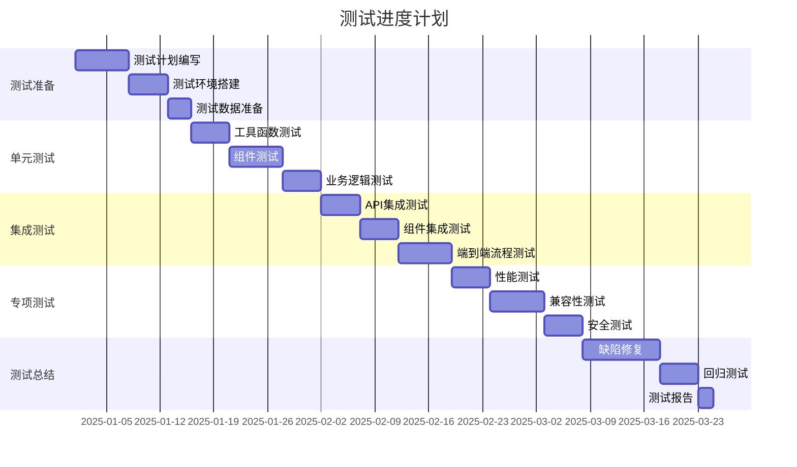
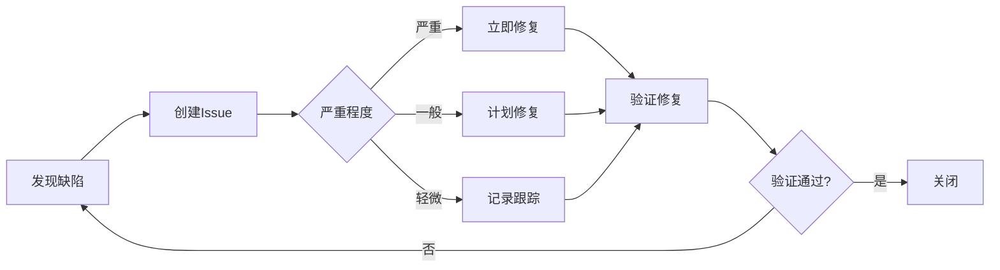

# BRClient 测试策略设计文档

## 文档信息
- **项目名称**: BRClient
- **文档版本**: v1.0
- **编制日期**: 2025年12月
- **编制人**: QA团队
- **基于文档**: 技术方案 v1.0

---

## 1. 测试策略概述

### 1.1 测试目标
- 确保产品功能完整性和正确性
- 验证性能指标达到设计要求
- 保证跨平台兼容性
- 确保安全性和数据完整性

### 1.2 测试原则
1. **测试左移**: 开发阶段即开始测试
2. **自动化优先**: 核心功能100%自动化
3. **持续集成**: 每次提交触发测试
4. **风险驱动**: 优先测试高风险模块

### 1.3 测试范围

#### 包含范围
- 功能测试：所有P0/P1功能
- 接口测试：AWS Bedrock API集成
- 性能测试：响应时间、资源占用
- 兼容性测试：Windows/macOS/Linux
- 安全测试：凭证存储、数据加密
- 用户体验测试：交互流畅度

#### 排除范围
- 第三方库内部逻辑
- AWS Bedrock服务本身
- 操作系统底层功能

---

## 2. 测试方法与策略

### 2.1 测试金字塔

```
         /\
        /  \        E2E测试 (10%)
       /----\       - 关键用户流程
      /      \      - 跨平台冒烟测试
     /--------\     
    /          \    集成测试 (30%)
   /------------\   - API集成测试
  /              \  - 组件集成测试
 /----------------\ 
/                  \ 单元测试 (60%)
--------------------
    - 函数级测试
    - 组件测试
```

### 2.2 测试类型

#### 2.2.1 单元测试
```
目标: 代码覆盖率 > 70%
工具: Jest + React Testing Library
范围:
- 工具函数
- React Hooks
- 业务逻辑模块
- 数据模型

示例:
describe('MessageService', () => {
  test('应该正确格式化消息', () => {
    const message = formatMessage({ content: 'Hello' });
    expect(message.role).toBe('user');
    expect(message.timestamp).toBeDefined();
  });
});
```

#### 2.2.2 集成测试
```
目标: 覆盖所有API和组件交互
工具: Jest + MSW (Mock Service Worker)
范围:
- API路由测试
- 组件集成测试
- 状态管理测试
- 数据库操作测试

示例:
test('应该成功创建对话', async () => {
  const response = await createConversation({
    title: 'Test',
    modelId: 'claude-3-sonnet',
  });
  expect(response.id).toBeDefined();
});
```

#### 2.2.3 E2E测试
```
目标: 覆盖核心用户流程
工具: Playwright / Cypress
范围:
- 首次使用流程
- 创建并进行对话
- 配置管理
- 数据导入导出

示例:
test('用户可以完成完整对话', async ({ page }) => {
  await page.goto('/');
  await page.click('[data-test="new-chat"]');
  await page.fill('textarea', 'Hello');
  await page.click('[data-test="send"]');
  await expect(page.locator('.message.assistant')).toBeVisible();
});
```

### 2.3 测试策略矩阵

| 功能模块 | 单元测试 | 集成测试 | E2E测试 | 手动测试 |
|---------|---------|---------|---------|---------|
| 对话管理 | ✓ | ✓ | ✓ | ✓ |
| 消息处理 | ✓ | ✓ | ✓ | - |
| AWS集成 | ✓ | ✓ | ✓ | ✓ |
| 配置管理 | ✓ | ✓ | ✓ | - |
| UI组件 | ✓ | ✓ | - | ✓ |
| 数据存储 | ✓ | ✓ | - | - |

---

## 3. 测试环境规划

### 3.1 环境配置

#### 3.1.1 开发环境
```yaml
目的: 开发人员本地测试
配置:
  - Node.js 18+
  - Jest + Testing Library
  - Mock AWS Services
  - 本地IndexedDB
特点:
  - 快速反馈
  - 完全隔离
  - 可调试
```

#### 3.1.2 CI环境
```yaml
目的: 自动化测试
配置:
  - GitHub Actions Runner
  - Docker容器
  - Mock所有外部服务
  - 内存数据库
特点:
  - 一致性
  - 并行执行
  - 报告自动生成
```

#### 3.1.3 预生产环境
```yaml
目的: 发布前验证
配置:
  - 真实AWS账号（测试）
  - 完整功能部署
  - 监控和日志
特点:
  - 接近生产
  - 完整功能验证
  - 性能测试
```

### 3.2 测试数据管理

#### 3.2.1 Mock数据
```typescript
// 对话Mock数据
export const mockConversations: Conversation[] = [
  {
    id: 'conv-1',
    title: '测试对话1',
    modelId: 'anthropic.claude-3-sonnet-20240229-v1:0',
    createdAt: Date.now() - 86400000,
    updatedAt: Date.now() - 3600000,
    isArchived: false,
    isPinned: false,
    tags: ['测试'],
  },
  // ... 更多数据
];

// AWS响应Mock
export const mockBedrockResponse = {
  body: {
    async *[Symbol.asyncIterator]() {
      yield { chunk: { bytes: new TextEncoder().encode('Hello') } };
      yield { chunk: { bytes: new TextEncoder().encode(' World') } };
    },
  },
};
```

#### 3.2.2 测试数据库
```typescript
// 使用in-memory数据库
import Dexie from 'dexie';
import 'fake-indexeddb/auto';

export function createTestDB() {
  const db = new BRClientDB();
  // 填充测试数据
  return db;
}
```

---

## 4. 自动化测试方案

### 4.1 单元测试配置

```javascript
// jest.config.js
module.exports = {
  preset: 'ts-jest',
  testEnvironment: 'jsdom',
  setupFilesAfterEnv: ['<rootDir>/jest.setup.js'],
  moduleNameMapper: {
    '\\.(css|less|scss|sass)$': 'identity-obj-proxy',
    '^@/(.*)$': '<rootDir>/app/$1',
  },
  collectCoverageFrom: [
    'app/**/*.{ts,tsx}',
    'client/**/*.ts',
    'services/**/*.ts',
    '!**/*.d.ts',
    '!**/node_modules/**',
  ],
  coverageThreshold: {
    global: {
      branches: 70,
      functions: 70,
      lines: 70,
      statements: 70,
    },
  },
};
```

### 4.2 集成测试框架

```typescript
// tests/integration/setup.ts
import { setupServer } from 'msw/node';
import { handlers } from './handlers';

export const server = setupServer(...handlers);

beforeAll(() => server.listen());
afterEach(() => server.resetHandlers());
afterAll(() => server.close());
```

### 4.3 E2E测试配置

```typescript
// playwright.config.ts
import { defineConfig } from '@playwright/test';

export default defineConfig({
  testDir: './e2e',
  fullyParallel: true,
  forbidOnly: !!process.env.CI,
  retries: process.env.CI ? 2 : 0,
  workers: process.env.CI ? 1 : undefined,
  use: {
    baseURL: 'http://localhost:3000',
    trace: 'on-first-retry',
    screenshot: 'only-on-failure',
  },
  projects: [
    {
      name: 'chromium',
      use: { ...devices['Desktop Chrome'] },
    },
    {
      name: 'webkit',
      use: { ...devices['Desktop Safari'] },
    },
  ],
  webServer: {
    command: 'yarn dev',
    port: 3000,
    reuseExistingServer: !process.env.CI,
  },
});
```

### 4.4 CI/CD集成

```yaml
# .github/workflows/test.yml
name: Test

on: [push, pull_request]

jobs:
  test:
    runs-on: ubuntu-latest
    
    steps:
      - uses: actions/checkout@v3
      
      - name: Setup Node.js
        uses: actions/setup-node@v3
        with:
          node-version: 18
      
      - name: Install dependencies
        run: yarn install
      
      - name: Run unit tests
        run: yarn test:unit --coverage
      
      - name: Run integration tests
        run: yarn test:integration
      
      - name: Run E2E tests
        run: yarn test:e2e
      
      - name: Upload coverage
        uses: codecov/codecov-action@v3
        with:
          files: ./coverage/lcov.info
      
      - name: Upload test results
        if: always()
        uses: actions/upload-artifact@v3
        with:
          name: test-results
          path: test-results/
```

---

## 5. 性能测试方案

### 5.1 性能指标

#### 5.1.1 响应时间指标
| 操作 | P50 | P95 | P99 | 目标 |
|------|-----|-----|-----|------|
| 应用启动 | 1.5s | 2s | 2.5s | <3s |
| 创建对话 | 50ms | 100ms | 150ms | <200ms |
| 发送消息(首字) | 800ms | 1.2s | 1.5s | <2s |
| 切换对话 | 100ms | 200ms | 300ms | <300ms |
| 搜索对话 | 100ms | 300ms | 400ms | <500ms |

#### 5.1.2 资源占用指标
```
内存:
- 空闲: < 150MB
- 使用中: < 500MB
- 峰值: < 800MB

CPU:
- 空闲: < 5%
- 生成中: < 30%
- 峰值: < 50%

磁盘:
- 应用: < 200MB
- 数据: < 10MB/千条对话
```

### 5.2 性能测试工具

#### 5.2.1 前端性能测试
```typescript
// Lighthouse CI配置
module.exports = {
  ci: {
    collect: {
      numberOfRuns: 3,
      url: ['http://localhost:3000'],
    },
    assert: {
      assertions: {
        'categories:performance': ['error', { minScore: 0.9 }],
        'categories:accessibility': ['error', { minScore: 0.9 }],
        'first-contentful-paint': ['error', { maxNumericValue: 2000 }],
        'interactive': ['error', { maxNumericValue: 3000 }],
      },
    },
  },
};
```

#### 5.2.2 负载测试
```typescript
// k6 负载测试脚本
import http from 'k6/http';
import { check, sleep } from 'k6';

export const options = {
  stages: [
    { duration: '1m', target: 10 },  // 升至10用户
    { duration: '3m', target: 10 },  // 保持10用户
    { duration: '1m', target: 0 },   // 降至0
  ],
  thresholds: {
    http_req_duration: ['p(95)<2000'], // 95%请求<2s
    http_req_failed: ['rate<0.01'],    // 错误率<1%
  },
};

export default function () {
  const response = http.post('http://localhost:3000/api/conversations', {
    title: 'Load Test',
    modelId: 'claude-3-sonnet',
  });
  
  check(response, {
    'status is 200': (r) => r.status === 200,
    'response time < 200ms': (r) => r.timings.duration < 200,
  });
  
  sleep(1);
}
```

#### 5.2.3 内存泄漏检测
```javascript
// 使用Chrome DevTools Memory Profiler
// 或者 Jest with --detectLeaks

test('应该不产生内存泄漏', async () => {
  const initialMemory = process.memoryUsage().heapUsed;
  
  // 执行1000次操作
  for (let i = 0; i < 1000; i++) {
    await createAndDeleteConversation();
  }
  
  // 强制GC
  if (global.gc) global.gc();
  
  const finalMemory = process.memoryUsage().heapUsed;
  const growth = finalMemory - initialMemory;
  
  // 内存增长应小于10MB
  expect(growth).toBeLessThan(10 * 1024 * 1024);
});
```

---

## 6. 兼容性测试方案

### 6.1 平台兼容性

#### 6.1.1 桌面平台
| 平台 | 版本 | 优先级 | 测试内容 |
|------|------|--------|----------|
| Windows | 10, 11 | P0 | 完整功能 |
| macOS | 11+ | P0 | 完整功能 |
| macOS | Apple Silicon | P0 | 性能优化 |
| Linux | Ubuntu 20.04+ | P1 | 核心功能 |
| Linux | Fedora 36+ | P2 | 核心功能 |

#### 6.1.2 浏览器兼容性（Web版）
| 浏览器 | 版本 | 优先级 | 测试内容 |
|--------|------|--------|----------|
| Chrome | 90+ | P0 | 完整功能 |
| Firefox | 88+ | P1 | 完整功能 |
| Safari | 14+ | P1 | 完整功能 |
| Edge | 90+ | P1 | 核心功能 |

### 6.2 兼容性测试矩阵

```
测试项          Windows  macOS-Intel  macOS-ARM  Linux
────────────────────────────────────────────────────────
应用启动          ✓         ✓           ✓        ✓
对话功能          ✓         ✓           ✓        ✓
AWS连接           ✓         ✓           ✓        ✓
数据存储          ✓         ✓           ✓        ✓
文件导出          ✓         ✓           ✓        ✓
快捷键            ✓         ✓           ✓        ✓
系统集成          ✓         ✓           ✓        △
自动更新          ✓         ✓           ✓        △

✓ = 完全支持  △ = 部分支持  ✗ = 不支持
```

---

## 7. 安全测试方案

### 7.1 安全测试清单

#### 7.1.1 认证与授权
- [ ] AWS凭证加密存储
- [ ] 凭证不在日志中泄露
- [ ] 凭证不通过HTTP传输
- [ ] 无凭证硬编码
- [ ] Token过期处理正确

#### 7.1.2 数据安全
- [ ] 敏感数据加密存储
- [ ] 数据传输使用HTTPS
- [ ] SQL注入防护
- [ ] XSS攻击防护
- [ ] CSRF攻击防护

#### 7.1.3 代码安全
- [ ] 依赖库无已知漏洞
- [ ] 无敏感信息在源码
- [ ] 输入验证完整
- [ ] 错误信息不泄露细节
- [ ] 安全头配置正确

### 7.2 安全测试工具

```bash
# 依赖扫描
yarn audit
npm audit

# SAST静态代码分析
yarn eslint --ext .ts,.tsx .
yarn run type-check

# 依赖漏洞扫描
snyk test
```

### 7.3 渗透测试场景

#### 7.3.1 凭证泄露测试
```
测试步骤:
1. 检查localStorage/sessionStorage
2. 检查网络请求
3. 检查日志文件
4. 检查崩溃报告
5. 检查内存转储

预期结果:
- 凭证仅存储在系统密钥链
- 网络传输加密
- 日志中无敏感信息
```

#### 7.3.2 注入攻击测试
```typescript
// XSS测试用例
test('应该防御XSS攻击', async () => {
  const maliciousContent = '<script>alert("XSS")</script>';
  
  const message = await sendMessage(maliciousContent);
  
  // 内容应该被转义
  expect(message.content).not.toContain('<script>');
  expect(message.content).toContain('&lt;script&gt;');
});
```

---

## 8. 测试工具选择

### 8.1 测试框架对比

| 工具 | 类型 | 优点 | 缺点 | 选择 |
|------|------|------|------|------|
| Jest | 单元测试 | 速度快、配置简单 | - | ✓ |
| Vitest | 单元测试 | ESM原生支持 | 生态较新 | - |
| Playwright | E2E | 跨浏览器、强大 | 学习曲线 | ✓ |
| Cypress | E2E | 调试友好 | 仅Chromium系 | - |
| k6 | 性能测试 | 脚本化、CI友好 | - | ✓ |
| JMeter | 性能测试 | 功能丰富 | 笨重 | - |

### 8.2 工具配置

```json
// package.json scripts
{
  "scripts": {
    "test": "jest",
    "test:unit": "jest --testPathPattern=unit",
    "test:integration": "jest --testPathPattern=integration",
    "test:e2e": "playwright test",
    "test:coverage": "jest --coverage",
    "test:watch": "jest --watch",
    "test:perf": "k6 run tests/performance/load-test.js",
    "test:security": "snyk test && yarn audit"
  }
}
```

---

## 9. 测试进度安排

### 9.1 测试时间表



### 9.2 里程碑

| 里程碑 | 日期 | 交付物 |
|--------|------|--------|
| 测试计划完成 | Week 1 | 测试计划文档 |
| 单元测试完成 | Week 4 | 覆盖率报告 |
| 集成测试完成 | Week 7 | 测试报告 |
| 专项测试完成 | Week 10 | 专项报告 |
| 测试验收 | Week 12 | 验收报告 |

---

## 10. 测试报告规范

### 10.1 测试报告模板

```markdown
# 测试报告 - [功能模块]

## 测试概况
- 测试日期: YYYY-MM-DD
- 测试版本: v1.0.0
- 测试人员: @tester
- 测试环境: macOS 13.0 / Windows 11

## 测试结果
- 总用例数: 100
- 通过: 95
- 失败: 3
- 阻塞: 2
- 通过率: 95%

## 缺陷统计
- 严重: 1
- 一般: 2
- 轻微: 3
- 建议: 5

## 详细结果
### 功能测试
| 功能 | 用例数 | 通过 | 失败 | 通过率 |
|------|--------|------|------|--------|
| 对话管理 | 20 | 20 | 0 | 100% |
| 消息处理 | 30 | 28 | 2 | 93.3% |
| ... | ... | ... | ... | ... |

### 性能测试
| 指标 | 目标 | 实际 | 结果 |
|------|------|------|------|
| 启动时间 | <3s | 2.1s | ✓ |
| 响应时间 | <2s | 1.8s | ✓ |

## 遗留问题
1. [BUG-001] 消息发送偶尔失败
   - 优先级: P1
   - 重现率: 10%
   - 修复计划: Week 13

## 测试结论
本次测试覆盖了主要功能模块，通过率达到95%，符合发布标准。
遗留的2个P1问题建议在下个版本修复。

## 签字
- 测试负责人: ___________
- 开发负责人: ___________
- 产品负责人: ___________
```

---

## 11. 附录

### 11.1 测试环境清单

```yaml
开发环境:
  OS: macOS 13+ / Windows 11
  Node: 18.0.0+
  Browser: Chrome latest
  Tools:
    - VS Code
    - Jest
    - React DevTools

CI环境:
  Platform: GitHub Actions
  OS: ubuntu-latest
  Node: 18.x
  Cache: yarn cache
  Parallel: 4 workers

测试账号:
  AWS:
    Region: us-east-1
    Access: Limited Bedrock access
    Budget: $100/month
```

### 11.2 缺陷管理流程



### 11.3 参考资料
- [Jest Documentation](https://jestjs.io/)
- [Playwright Documentation](https://playwright.dev/)
- [k6 Documentation](https://k6.io/docs/)
- [OWASP Testing Guide](https://owasp.org/www-project-web-security-testing-guide/)

### 11.4 版本记录
| 版本 | 日期 | 更新内容 | 作者 |
|------|------|----------|------|
| v1.0 | 2025-12-21 | 初始测试方案 | QA团队 |

---

**文档结束**
